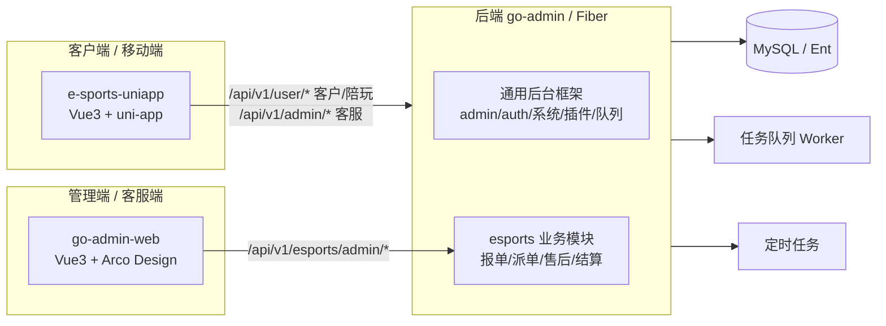
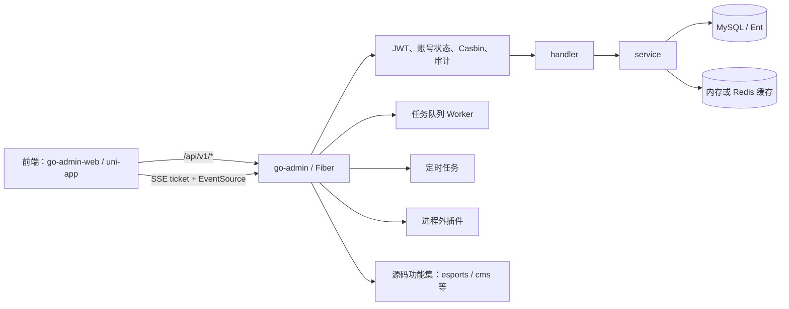
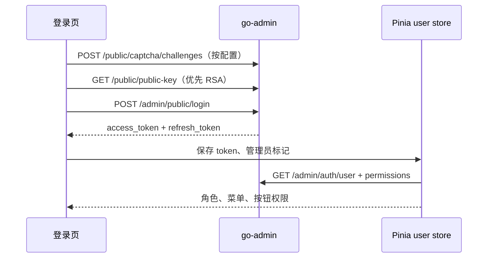

# 陪玩报单系统 Code Wiki

> 范围：同级目录中的三套代码 —— `go-admin`（后端）、`go-admin-web`（管理端前端）、`e-sports-uniapp`（uni-app 客户端/陪玩端/客服端）。依据 2026-10-16 工作区源码整理。本文使用相对路径，作为三个独立 Git 仓库的统一入口；接口和行为以源码为准。

## 0. 系统全景

这是一套**陪玩报单系统**，业务代号 `esports`，构建在通用 Go 管理后台框架 `github.com/wuwuseo/cmf`（go-admin）之上。三端分工如下：

| 仓库 | 角色 | 技术栈 | 身份 |
| --- | --- | --- | --- |
| [go-admin](go-admin) | 后端 | Go + Fiber v3 + Ent + Casbin | 提供 admin/user 双登录 + esports 业务 |
| [go-admin-web](go-admin-web) | 管理端/客服端 | Vue3 + TS + Vite + Arco Design + Pinia | admin（客服/超管） |
| [e-sports-uniapp](e-sports-uniapp) | 客户端/陪玩端/移动客服端 | Vue3 + TS + uni-app | customer（客户）、player（陪玩）、cs（客服） |

版本分别见 [go.mod](go-admin/go.mod)、[go-admin-web/package.json](go-admin-web/package.json)、[e-sports-uniapp/package.json](e-sports-uniapp/package.json)。开发时前端 Vite 代理 `/api` 到后端 `127.0.0.1:9501`；生产时后端 [main.go](go-admin/main.go) 将 `web/dist` 编入二进制。三个仓库独立管理源码，共同组成一套系统。

> ⚠️ **esports 业务功能开关**：esports 模块默认关闭；只要设置 `ESPORTS_EXPERIMENTAL=1` 即可启用，**不再要求 `CMF_APP_ENV=development`**（生产环境同样按该变量显式开启，见 [app.go](go-admin/internal/apps/esports/app.go) 的 `experimentalEnabled`）。启用前需按 [esports 业务 README](go-admin/internal/apps/esports/README.md) 的验收清单逐项自检（含 `app.esports.payment_deadline_minutes` 非零、收款渠道与通知通道配置）。

---

## 1. 一张图看后端

后端是 Go 1.25.1 + Fiber v3 + Ent + Casbin，通过 `github.com/wuwuseo/cmf` 提供基础设施。esports 业务作为「源码功能集」编入同一 Go 进程，挂载在 `/api/v1/esports` 前缀下。

## 2. 先看哪些文件

| 想了解 | 前端入口（管理端） | 前端入口（客户端） | 后端入口 |
| --- | --- | --- | --- |
| 启动与依赖 | [main.ts](go-admin-web/src/main.ts)、[package.json](go-admin-web/package.json) | [main.ts](e-sports-uniapp/src/main.ts)、[package.json](e-sports-uniapp/package.json) | [main.go](go-admin/main.go)、[wire.go](go-admin/internal/wire.go)、[provider.go](go-admin/internal/provider.go) |
| 路由与菜单 | [router/index.ts](go-admin-web/src/router/index.ts)、[source-apps.ts](go-admin-web/src/router/source-apps.ts) | [pages.json](e-sports-uniapp/src/pages.json)（tabBar/页面注册） | [router.go](go-admin/internal/router.go)、[apps.go](go-admin/internal/apps/apps.go)、[esports app.go](go-admin/internal/apps/esports/app.go) |
| 登录与权限 | [登录表单](go-admin-web/src/views/login/components/login-form.vue)、[user store](go-admin-web/src/store/modules/user/index.ts)、[usePermission](go-admin-web/src/hooks/permission.ts) | [登录页](e-sports-uniapp/src/pages/login/index.vue)、[客服登录](e-sports-uniapp/src/pages/cs/login.vue)、[request.ts](e-sports-uniapp/src/api/request.ts) | [admin_auth.go](go-admin/internal/handler/admin_auth.go)、[permission.go](go-admin/internal/middleware/permission.go) |
| HTTP 契约 | [api.ts](go-admin-web/src/apps/esports/api.ts) | [esports.ts](e-sports-uniapp/src/api/esports.ts)、[player.ts](e-sports-uniapp/src/api/player.ts)、[cs.ts](e-sports-uniapp/src/api/cs.ts) | [esports app.go](go-admin/internal/apps/esports/app.go) 的 `Routes` 列表 |
| 业务与数据 | [views](go-admin-web/src/apps/esports/views) | [pages](e-sports-uniapp/src/pages) | [esports 业务逻辑](go-admin/internal/apps/esports)、[schema](go-admin/internal/apps/esports/schema) |
| 业务权威文档 | — | [README.md](e-sports-uniapp/README.md) | [esports README](go-admin/internal/apps/esports/README.md)（逐节实现状态） |

后端的 Ent schema 是模型定义（通用系统在 `internal/ent/schema`，esports 业务在 `internal/apps/esports/schema`），其余大量 Ent 文件是生成代码，修改后需按 [AGENTS.md](go-admin/AGENTS.md) 重新生成，不要直接改生成文件。

## 3. 启动与请求链

### 后端启动

1. [main.go](go-admin/main.go) 调用 Wire 生成的 `InitializeApp` 构造配置、日志、数据库、缓存、文件系统、Ent 和 Casbin 依赖。
2. `internal.Init` 初始化数据库和 Casbin、定时任务、队列 Worker、验证码/密钥、SSE Hub，并写入初始管理员、权限、字典和系统配置。Ent 自动迁移位于 [provider.go](go-admin/internal/provider.go)。
3. [router.go](go-admin/internal/router.go) 注册 `/api/v1`，为具体路由注入 service，并挂载管理端、用户端、插件和源码功能集（esports/cms）路由。
4. [main.go](go-admin/main.go) 对非 `/api/`、非 `/uploads/` 路径提供内嵌静态文件和 SPA fallback。

典型 API 链为：路由 → JWT/域/账号状态/权限/审计中间件 → `internal/handler` 或 `internal/apps/esports` 的 handler 解析与校验请求 → service 处理业务 → Ent/缓存/文件系统/队列。响应主体通常是 `{code, message, data}`；后端成功码为 `1` 或 `2`（[msg.go](go-admin/internal/global/msg.go)），前端据此判断业务成功，HTTP 401 触发重新登录。

### 前端启动

- **管理端** [main.ts](go-admin-web/src/main.ts) 注册 Arco、Vue Router、Pinia、i18n、全局组件与 Axios 拦截器。路由使用 history 模式，`source-apps.ts` 根据后端权限树动态注册 esports 等功能集路由。
- **客户端** [main.ts](e-sports-uniapp/src/main.ts) 使用 `createSSRApp`，[App.vue](e-sports-uniapp/src/App.vue) 在 `onLaunch` 做冷启动身份分流（无任何 token 则跳登录页）。

## 4. 登录与权限：三端完整流程

### 双 JWT 密钥体系（关键）

| 身份 | JWT 密钥 | 登录接口 | 有效期 | 鉴权头 |
| --- | --- | --- | --- | --- |
| admin（客服/超管） | `CMF_APP_ADMIN_SECRET` | `POST /api/v1/admin/public/login` | 7200s（2h） | `Bearer <admin token>` |
| user（客户 customer / 陪玩 player） | `CMF_APP_SECRET` | `POST /api/v1/user/login` | 86400s（24h） | `Bearer <user token>` |

- **同一 User 可同时是客户和陪玩**：登录后通过探测「是否有陪玩档案」来分流到陪玩端或客户自助端。
- **客服即管理员**：客服与管理员共用 `ent.Admin` 身份，用 `isSuperAdmin` 区分超管；非超管数据按 `owner_admin_id`/`responsible_admin_id` 收敛到本人。

### 登录流程（管理端）

### 登录分流（uni-app 客户端）

| 身份 | token key | 登录接口 | 分流判断 | 落点 |
| --- | --- | --- | --- | --- |
| customer 客户 | `esports_token` | `/api/v1/user/login` | 登录后探测陪玩档案**失败** | `pages/index/index` |
| player 陪玩 | `esports_token` | `/api/v1/user/login` | 登录后探测陪玩档案**成功** | `pages/player/home` |
| cs 客服 | `esports_admin_token` | `/api/v1/admin/public/login` | 独立 token + 独立请求层 | `pages/cs/workbench` |

客户/陪玩共用 `request()`（[request.ts](e-sports-uniapp/src/api/request.ts)），客服用独立的 `csRequest()`（[cs.ts](e-sports-uniapp/src/api/cs.ts)），两者 401 跳转目标、token key、登录路径均不同。admin/user 登录当前 captcha 场景均未启用，纯账号密码即可登录（[login.vue](e-sports-uniapp/src/pages/login/index.vue)、[cs/login.vue](e-sports-uniapp/src/pages/cs/login.vue) 均未接验证码）。

### 权限中间件

后端 `/admin/auth` 先校验管理员 JWT、域和账号状态，再由 [PermissionMiddleware](go-admin/internal/middleware/permission.go) 用 Casbin 按 `域 + 资源路径 + HTTP 方法` 判定接口权限。esports 的 `AuthAdmin` 链在此基础上叠加 `PermissionMiddleware`，`AuthUser` 链则只做 JWT + 域 + 账号状态校验（不校验 Casbin）。前端 `v-permission`、`usePermission` 只控制页面/按钮可见性，不能代替后端鉴权。管理端 `role === 'admin'` 直接绕过所有按钮/菜单权限校验。

## 5. esports 业务全景

### 5.1 业务领域划分（后端 20+ 领域）

esports 后端约 400 个 `.go` 文件（非测试 175 个 + 测试 230 个，2026-10-24 实数），`internal/ent/migrate/schema.go` 中 87 张 `esports_*` 数据表（2026-10-24 实数；储值卡移除后为 89 张，2026-10-22 单一商品迁移删 `esports_skus` / `esports_spec_groups` / `esports_sku_suspensions` 三表、新增 `esports_product_suspensions`，净减 2）。核心业务领域如下（文件均在 `internal/apps/esports/`，忽略 `_test.go`）：

| 领域 | 核心文件 | 说明 |
| --- | --- | --- |
| 商品与目录 | `product.go`、`service.go`、`sku_suspension.go` | 单一商品（每件一个价格/服务量/结单规则/库存、固定一人服务）、content 内容图片、分类、商品停服；文件名保留 `service.go`/`sku_suspension*`（handler 名仍为 `*Sku`），路由已迁至 `/admin/products` |
| 订单/报单 | `service.go`、`order_ops.go`、`confirmation.go`、`cancel_policy.go`、`reschedule_proposal.go`、`addon.go`、`deposit.go`、`admin_backfill.go` | 下单、改价/改期/取消、报价确认、加钟、存单、补录 |
| 客户 | `customer_self.go`、`customer_cancel.go` | 客户自助下单/查单/档案 |
| 年龄核验 | `age_check.go` | 年龄资格提交/复核 |
| 收款/支付 | `payment.go`、`payment_account.go`、`offline_payment.go`、`payment_reversal.go`、`external_refund.go` | 支付意图、收款账户、待核验收款、渠道撤销、外部退款 |
| 排单/派单 | `dispatch.go`、`dispatch_priority.go`、`dispatch_ranking.go`、`dispatch_remind.go`、`dispatch_transfer.go`、`teammate.go` | 排单看板、席位指派、优先派单、抢单、转单、固排 |
| 陪玩 | `player.go`、`player_heartbeat.go`、`player_credit.go`、`player_recovery.go` | 陪玩档案、心跳、信用、追偿 |
| 服务 | `service_duration.go`、`service_evidence.go`、`service_pause.go` | 服务段计时、凭证、暂停/恢复 |
| 结单规则 | `close_rule.go`、`close_condition.go`、`close_form.go`、`close_submit_rule.go`、`close_approval.go` | 结单规则/条件树/表单/提交规则/审批流（均版本化） |
| 售后 | `aftersale.go`、`aftersale_actions.go`、`aftersale_evidence.go`、`aftersale_review.go`、`aftersale_sla.go`、`fulfillment_makeup.go` | 售后状态机、多动作方案、凭证、复核、SLA、补履约 |
| 礼物 | `gift.go`、`gift_intent.go`、`gift_dispute.go` | 礼物目录/送礼/退款/榜单/争议 |
| 充值/营销 | `recharge_intent.go`、`recharge_refund_quote.go`、`recharge_refund_execute.go`、`campaign.go` | 充值意图、退款试算/执行、充值活动 |
| 钱包 | `wallet.go`、`wallet_display.go` | 钱包账户/流水、展示口径 |
| 账本 | `ledger_allocation.go`、`ledger_reconcile.go` | 批次分摊、账本核验 |
| 会员 | `member.go` | 会员等级、成长值、手动调级 |
| 分成/结算 | `commission.go`、`commission_schedule.go`、`settlement.go`、`settlement_cycle.go` | 陪玩分成、结算单、结算周期 |
| 客服提成 | `cs_commission.go`、`cs_commission_auto.go` | 客服提成规则/明细/结算 |
| 提现 | `withdrawal.go`、`withdrawal_payout.go` | 提现申请/审核/打款 |
| 客服工作台 | `cs.go` | 客户档案/跟进/话术/工作台聚合 |
| 考核/评价 | `assessment.go` | 考核权重/任务/打分/申诉/客户评价 |
| 报表 | `report.go`、`report_export.go` | 经营统计报表、CSV 导出 |
| 页面装修 | `page.go` | 首页装修草稿/发布/回滚/素材 |
| 风控 | `risk.go` | 风险名单/自动标记/人工标记 |
| 基础设施 | `outbox.go`、`order_timeline.go` | 事务外盒、订单时间线 |

### 5.2 核心数据模型（87 张表，重点）

| 表 | 实体 | 用途 |
| --- | --- | --- |
| `esports_products` / `esports_product_categories` / `esports_product_suspensions` | Product/Category/Suspension | 单一商品（每件一个价格/服务量/结单规则/库存、固定一人服务；2026-10-22 起 `esports_skus` 原行迁入，父商品与规格组已删）、分类、商品停服 |
| `esports_orders` | EsportsOrder | 订单主表（履约/支付/退款/加钟等状态） |
| `esports_customers` | EsportsCustomer | 客户档案（含风控/会员/企微字段） |
| `esports_players` | EsportsPlayer | 陪玩档案（资格/在线/等级/上限） |
| `esports_wallet_accounts` / `esports_wallet_txes` | WalletAccount/WalletTx | 钱包账户登记 + 流水（余额由流水求和派生，不落库） |
| `esports_after_sales` | EsportsAfterSale | 售后单（状态机） |
| `esports_gifts` / `esports_gift_orders` / `esports_gift_disputes` | Gift 系列 | 礼物目录/送礼单/争议 |
| `esports_commission_rules` / `esports_commission_entries` | Commission 系列 | 陪玩分成规则/明细 |
| `esports_settlements` / `esports_settlement_cycles` | Settlement 系列 | 结算单/结算周期 |
| `esports_dispatch_seats` | EsportsDispatchSeat | 派单席位 |
| `esports_service_segments` | EsportsServiceSegment | 服务段（计时） |
| `esports_close_rules` 及配套 | Close 系列 | 结单规则/表单/审批 |
| `esports_member_level_rules` / `esports_growth_ledgers` | Member 系列 | 会员等级/成长值流水 |
| `esports_ledger_entries` / `esports_ledger_allocations` | Ledger 系列 | 账本流水/分摊 |
| `esports_idempotencies` / `esports_outboxes` | Infra | 幂等记录/事务外盒 |

> **重要设计约束**：余额、成长值均为「流水求和派生」，不落库；`wallet_tx`/`ledger_entry`/`idempotency` 为只增表。分成/结单/充值活动等规则普遍采用「改规则=新增 version」的乐观锁模式。

### 5.3 主流程：报单 → 派单 → 服务 → 结单 → 结算

1. **报单**：客服 `POST /admin/orders`（或客户 `POST /user/orders`）→ 校验客户归属/年龄/商品在售/重复报单 → 原子占用商品名额 → 按「商品价→会员折扣→人工调整」算应付 → 落配额占用 + 幂等记录。
2. **收款**：待付款订单经余额核销 / 外部到账核验 → 转待派单；超时由 `esports_expire_orders` 释放名额。
3. **派单**：按 `required_seats` 生成席位 → 客服指派/公共池认领/抢单大厅/固排成队；接单硬校验陪玩资质 + 在线 + 分区 + 技能等级 + 接单上限。
4. **服务**：陪玩 `service/start` 开始，写服务段（上报服务量 + 系统秒数）；支持暂停/恢复/加钟/断线自动暂停；席位全结束转待结单。
5. **结单**：客服 `POST /admin/orders/:id/close` 校验结单规则 + 表单 + 提交规则 + 审批流（金额达阈值转待复核）→ 订单 completed，计提陪玩分成/客服提成/客户成长值。两条硬性契约：① 订单存在**图片**服务凭证时，必须回传覆盖全部图片附件的 `viewed_evidence_attachment_ids`（清单由 `GET /admin/orders/:id/close-form` 或 `close-conditions` 的 `evidence_attachment_ids` 提供）；② 提交规则要求逐人提交时，每个在册席位都要有提交（代提交的凭证须为图片附件 ID，文本不计入规则张数）。
6. **结算**：分成明细按陪玩聚合 → 生成结算单 → 锁定转 settled 并写猫粮钱包流水；客服提成走独立结算单（**草稿只「挂单」不置 settled，锁定 + 登记外部发放时才转 settled**；支持作废/重开，作废为软作废 `status=void`）。结单事件快照单列 `addon_revenue_cents` / `addon_commission_cents` / `close_net_total_cents`（加钟口径）。

## 6. 功能地图：页面 → API → 后端

### 6.1 管理端（go-admin-web / src/apps/esports）

管理端 esports 是「源码功能集(source-app)」，路由与菜单**完全由后端权限树驱动**（[source-apps.ts](go-admin-web/src/router/source-apps.ts) 用 `import.meta.glob` 静态收录本地页面 + 动态 `addRoute`），非前端硬编码。API 封装集中在 [api.ts](go-admin-web/src/apps/esports/api.ts)（约 306 个导出、344 个类型/接口、291 处 `axios` 调用，2026-10-24 实测），管理端走 `/api/v1/esports/admin` 前缀；陪玩端自助接口**不**在本文件留副本（早期误抄的 19 个 `/user/player/*` 封装已删除，客户端能力以 `e-sports-uniapp/src/api/*` 为准）。金额与百分比换算统一用 big.js 高精度计算。

18 个视图页面（`views/<目录>/index.vue`）：

| 视图目录 | 菜单码 | 功能 |
| --- | --- | --- |
| `orders` | `esports:order` | 订单列表 + 改价审批、补录、取消、改期、加钟、余额支付、押金、恢复 |
| `reports` | `esports:report` | 客服报单（客服代下单/建档/年龄核实） |
| `cs` | `esports:cs` | 客服工作台（工作台/我的客户/话术库） |
| `aftersales` | `esports:aftersale` | 售后单处理（创建/受理/方案/审批/执行/撤回） |
| `assessments` | `esports:assessment` | 考核权重、考核任务、申诉复核、客户评价 |
| `campaigns` | `esports:campaign` | 充值营销活动 |
| `close-forms` | `esports:close_form` | 结单表单四件套（字段库/模板/提交规则/审批流） |
| `dispatch` | `esports:dispatch` | 排单看板（多泳道 + 派单优先级/座位转让） |
| `gifts` | `esports:gift` | 礼物目录、送礼单、榜单、纠纷处理 |
| `members` | `esports:member` | 会员等级配置、成长值流水、手动调级 |
| `pages` | `esports:page` | 页面装修（装修/发布记录/素材库） |
| `payments` | （收款子页） | 收款方式启停、收款账户审核、待核验收款 |
| `players` | `esports:player` | 陪玩列表与档案管理 |
| `products` | `esports:product` | 商品管理（单一商品模型 + content 内容图片多选）与分类 |
| `risk-customers` | `esports:risk` | 客户风控名单 |
| `settlements` | `esports:settlement` | 结算（分成/客服提成/结算单/提现/结单规则/结算周期/追偿） |
| `stats` | `esports:stats` | 经营总览/客服业绩/派单效率/售后质量报表 |
| `wallets` | `esports:wallet` | 钱包（客户余额/陪玩猫粮，余额/流水/充值/调账） |

权限码规范为三段式 `esports:<资源>:<动作>`（如 `esports:orders:operate`、`esports:wallets:manage`、`esports:stats:finance`）。注意**视图目录名 ≠ 菜单码 ≠ 权限码中段**三套命名存在差异（如 `reports` 目录 → `esports:report` 菜单，含义是「报单」而非「报表」；`stats` 才是「报表」）。

特色组件：[close-condition-designer](go-admin-web/src/apps/esports/components/close-condition-designer)（结单条件设计器），递归条件树（and/or/not + 字段/运算符/值），与后端 [close_condition.go](go-admin/internal/apps/esports/close_condition.go) 口径强耦合，约束为深度 ≤ 5、节点 ≤ 50，7 个可选字段（凭证张数/服务时长/服务量/承诺量/加钟量/待处理加钟数/进行中售后数；原第 8 个「储值卡一致」随储值卡功能于 2026-10-20 移除）。

### 6.2 客户端（e-sports-uniapp）

41 个页面（[pages.json](e-sports-uniapp/src/pages.json)，2026-10-20 移除购卡页与客服侧储值卡页后由 43 降为 41），3 个 tabBar（报单/订单/我的）。API 分四层：

| API 文件 | 身份 | 函数数 | 接口前缀 |
| --- | --- | --- | --- |
| [request.ts](e-sports-uniapp/src/api/request.ts) | user（客户+陪玩） | 请求层 + token 工具 | 基础封装 |
| [esports.ts](e-sports-uniapp/src/api/esports.ts) | customer | 52 | `/skus`、`/user/*` |
| [player.ts](e-sports-uniapp/src/api/player.ts) | player | 61 | `/user/player/*` |
| [cs.ts](e-sports-uniapp/src/api/cs.ts) | cs 客服 | 75 | `/admin/*` |
| [upload.ts](e-sports-uniapp/src/api/upload.ts) | user | 1 | `/api/v1/auth/attachments/upload` |

> **路径拼接约定**：`request()` 只做 `${API_BASE}${options.url}`，**不自动拼接 `/api/v1/esports`**。业务 CRUD 用相对路径（`/skus`、`/user/*`、`/admin/*`），登录和附件上传用完整路径（`/api/v1/user/login`、`/api/v1/admin/public/login`、`/api/v1/auth/attachments/upload`）。完整前缀依赖 `VITE_API_BASE` 环境变量取值。

页面分类：

| 目录 | 页面 | 说明 |
| --- | --- | --- |
| `index/` | `index` | 首页（tabBar）：装修配置 + 在售商品 |
| `login/` | `index` | 客户/陪玩统一登录 |
| `order/` | `list`、`create`、`detail` | 我的订单、自助下单、订单详情 |
| `aftersale/` | `list` | 我的售后（确认/拒绝方案） |
| `gift/` | `intents`、`disputes` | 待确认礼物、礼物与争议 |
| `wallet/` | `index` | 余额（本金/赠送） |
| `mine/` | `index` | 我的（tabBar）：会员/成长值/客服入口 |
| `player/` | `home`、`hall`、`orders`、`wallet`、`addons`、`notices`、`profile`、`identity`、`transfer`、`assessments`、`recoveries`、`appeals`、`teammates`（13） | 陪玩工作台/抢单/订单/猫粮钱包/加钟/优先通知/我的/实名/转单/考核/追偿/申诉/固排 |
| `cs/` | `login`、`workbench`、`customers`、`customer-detail`、`order-create`、`orders`、`order-detail`、`after-sales`、`scripts`、`member-levels`、`gift`（11） | 客服登录/工作台/客户/档案/报单/订单池/订单详情与结单/售后/话术库/会员权益/礼物（原第 12 页储值卡已随功能移除） |
| `reviews/` | `index` | 我的评价：评价列表 + 申诉（`GET /user/reviews`、`POST /user/reviews/{id}/appeal`） |
| `member/` | `priority-booking` | 会员优先预约：选陪玩 + 档期 + 提交意向（`POST /user/priority-bookings`） |

附件上传机制：[upload.ts](e-sports-uniapp/src/api/upload.ts) 用 `uni.uploadFile`（`name: 'file'` + `formData.directory`），目录约定 `private/esports/service-evidence`（陪玩服务截图）、`private/esports/aftersale`（售后凭证）；[evidence.ts](e-sports-uniapp/src/utils/evidence.ts) 提供 `pickEvidenceAttachments()` 统一选择并逐张上传返回附件 ID 列表。

## 7. 数据与扩展点

主库默认 MySQL `go_admin`，配置表前缀 `admin_`。Ent schema 分两处：通用系统实体在 [internal/ent/schema](go-admin/internal/ent/schema)（Admin/User/Role/Casbin/附件/消息/定时任务等），esports 业务实体在 [internal/apps/esports/schema](go-admin/internal/apps/esports/schema)（87 张 `esports_*` 表，2026-10-24 实数；单一商品迁移后 `esports_skus`/`esports_spec_groups`/`esports_sku_suspensions` 已删、新增 `esports_product_suspensions`）。`Admin` 和 `User` 是不同账号表、使用不同 JWT 密钥。用户密码变更通过 `token_version` 参与失效判定。

源码功能集位于后端 [internal/apps](go-admin/internal/apps)，编入同一 Go 进程；启动挂钩统一经 [internal/apps/apphook](go-admin/internal/apps/apphook/apphook.go) 的 `Extension`（8 钩子：字典种子 DictSeeds、配置播种 SeedConfig、退役权限、Casbin p 规则迁移/清理、菜单路径迁移、任务种子 CronSeeds、基准数据 SeedBaseline）向宿主声明，esports 在 [provision.go](go-admin/internal/apps/esports/provision.go) 自注册（含空表时播种示例充值活动草稿）。声明 `Dicts` 的功能集在启动时把缺失的 `(dict_type, value)` 幂等插入 `dict_data`（esports 已声明 `sys_config_group/esports` 业务配置分组，cmf v1.4.0 起允许功能集为核心字典补种子）。管理端页面在 [src/apps](go-admin-web/src/apps)，uni-app 客户端独立仓库。新功能集要同时维护两侧目录、API 权限定义与页面资源。详细约定见 [后端功能集文档](go-admin/docs/source-apps.md) 和 [前端功能集文档](go-admin-web/docs/source-apps.md)。

队列默认 `asynq`（`queue_redis` DB 1），即使缓存选 `memory`，启动仍需队列 broker 可用。定时任务由 [internal/cron](go-admin/internal/cron) 管理，esports 注册了 36 个 `esports_*` 任务（过期订单/邀请/赠送、优先派单重算、结单审批超时、账本核验、结算单自动生成、会员调级覆盖到期、优先预约意向过期等，注册表与 `cron_seeds.go` 逐条对应；储值卡到期与自助购卡意图两个任务已于 2026-10-20 移除，注册 / 种子数由 38 降为 36）。SSE 用 `/admin/auth/sse/ticket` 换取短期票据。

## 8. 本地运行、构建与检查

1. 按 [config.yml](go-admin/config/config.yml) 准备 MySQL 与任务队列 broker（默认 Redis），设置数据库连接、密钥等环境变量。生产密钥至少涉及 `CMF_APP_SECRET`、`CMF_APP_ADMIN_SECRET`；生产数据库密码应通过 `CMF_DATABASE_CONNECTIONS_DEFAULT_PASSWORD` 提供。OAuth 若启用，按 [OAuth 文档](go-admin/docs/oauth-github.md) 配置。esports 业务设置 `ESPORTS_EXPERIMENTAL=1` 即启用（与 `CMF_APP_ENV` 取值无关）。
2. 在 `go-admin-web` 执行 `pnpm install`、`pnpm run build`。由于 [main.go](go-admin/main.go) 的 `//go:embed web/dist`，启动后端前需把前端产物放到 `go-admin/web/dist`。
3. 管理端开发：`go-admin-web` 执行 `pnpm run dev`，Vite 代理 `/api` 到 `http://127.0.0.1:9501`。客户端开发：`e-sports-uniapp` 执行 `pnpm dev:h5`（或 `pnpm dev:mp-weixin` 小程序）。
4. 检查命令：后端 `go test ./...`；管理端 `pnpm run type:check`、`pnpm run build`；客户端 `pnpm type-check`（`vue-tsc --noEmit`）。改动 API 后重新生成 Swagger，改动 Ent schema 后 `go generate ./internal/ent`（esports 业务用 `go generate ./internal/apps`）。

## 9. 当前源码中的联调注意点

- 管理端 [src/api/user.ts](go-admin-web/src/api/user.ts) 的 `adminRefreshToken` 是管理员刷新接口的准绳；另有未使用的 `refreshToken()` 指向 `/api/v1/admin/refresh-token`，与后端普通用户刷新接口 `/api/v1/public/refresh-token` 不符，使用前应对齐契约。
- esports 客户端 `request.ts` 的路径拼接是「url 直接拼在 API_BASE 后」，[README.md](e-sports-uniapp/README.md) 中「会拼接 `/api/v1/esports`」的表述与实现不一致，以 `request.ts` 源码为准。
- `VITE_ADMIN_LOGIN_PATH` 在 [env.d.ts](e-sports-uniapp/src/env.d.ts) 中未声明（只有 `VITE_API_BASE`、`VITE_USER_LOGIN_PATH`），虽运行时可用但 TS 类型层未覆盖。
- `vue-i18n` 在 uni-app 的 package.json 中已依赖但未实际接入（main.ts 未注册，全项目未调用）。
- `go-admin-web` 构建后的页面依赖后端权限种子与前端页面同时存在。新增菜单要核对 `menu_path`、`component`、角色赋权与本地 `.vue` 文件；只隐藏按钮不会限制接口访问。
- esports 后端 `README.md`（13.6 万字节）是逐节实现状态的权威口径，含大量 `ponytail:`（未实现）标注；接口路径与 handler 名以 [app.go](go-admin/internal/apps/esports/app.go) 的 `Routes` 列表为准。

## 10. 整改要点与后续增量（2026-10-19 整改 → 10-20 清零与功能移除 → 10-21~10-24 增量）

2026-10-19 针对 [审核报告](陪玩报单系统-功能列表-审核报告.md) 的 18 个 P0 与 P1 缺口完成整体整改，逐条结论 / 改了什么 / 涉及文件 / 回归测试见该报告 [附录 B：整改记录](陪玩报单系统-功能列表-审核报告.md#附录-b整改记录)。对本 wiki 有影响的要点：

- **启用条件**：esports 只认 `ESPORTS_EXPERIMENTAL=1`（与 `CMF_APP_ENV` 取值无关），见 §0 提示与 §8-1。
- **结单**：订单有图片凭证时 `viewed_evidence_attachment_ids` 为强制契约；`GET /admin/orders/:id/close-form` 已透出 `evidence_attachment_ids`；逐人提交模式下每个在册席位都要提交。
- **结算**：客服提成草稿只「挂单」不置 settled；结算单新增 `void` / `version` / `voided_*`；`GET /admin/settlements?status=` 支持 `draft|locked|paid|void|all`（默认排除作废单）。
- **外部退款**：外部渠道售后退款改为登记「待执行外部退款单」（`AS-EXT-<售后单号>[:a<序号>]` 幂等），由财务核验后执行。
- **收款**：余额核销前会拦「该单已有待核验转账凭证」（原同口径还覆盖储值卡核销，该路径已于 2026-10-20 随功能移除）；退卡出账需打款凭证 + 财务角色（退卡功能已于 2026-10-20 一并移除，见下条 2026-10-20 记录）。
- **接线**：管理端 `api.ts` 补齐 70 个封装、删除 19 个误抄的 `/user/player/*` 封装；16 个既有视图完成接线（未新增视图目录，仍 19 个）。
- **安全**：装修渠道白名单（首版仅 `uni_customer_home`）、发布前图片探测走 `page_allowed_domains`、素材 `mime`/`size_bytes` 必填。
- **定时任务**：由 35 增至 37（+会员调级覆盖到期、+优先预约意向过期）；清零轮 +外部退款督办到 **38**；2026-10-20 移除储值卡两个任务后为 **36**（注册 36 / 种子 36，逐条对应）。
- **收尾轮增量（2026-10-19 晚，两批改动）**：管理端新增 4 条路由——售后代客确认 `POST /admin/after-sales/{id}/confirm`（权限码 `esports:aftersales:confirm`，**只做「待客户确认 → 待审批」，不等于审批**）、档期处置可用动作 `GET /admin/orders/{id}/appointment/disposal-options`、服务段计时 `GET /admin/orders/{id}/players/{playerId}/service/timing`（上界与更正校验同源）、充值退款批次 `GET /admin/recharge-refund-executions`；用户侧新增 3 条读路由 `GET /user/reviews`、`GET /user/reschedule-proposals`、`GET /user/player/reschedule-proposals`；行为变更两处——`GET /admin/settlements/{id}` 的 `entries` 按 `owner_type` 分流（cs 单不再为空）、调级入参新增 `override_days` / `override_until`（二选一）。客户端新增「我的评价」页与会员优先预约页、客户 / 陪玩两侧待确认改期列表，并补齐移动客服端结单的 `viewed_evidence_attachment_ids` 回传（P0-1 完全闭环）。
- **清零轮增量（2026-10-19 深夜，9 份子代理报告）**：新增 3 条管理端路由——`POST /admin/cs-commission-entries/{id}/freeze`、`POST /admin/cs-commission-entries/{id}/unfreeze`（权限码 `esports:settlements:cs_entry_freeze` / `cs_entry_unfreeze`）、`DELETE /admin/member-levels/{id}`（`esports:members:level_delete`）；新增定时任务 `esports_expire_pending_external_refunds`（`0 15 * * * *`，阈值是代码内常量 24h，只督办不改单；任务注册 / 种子由 37 增至 **38**）；新增存量修复命令 `go run ./cmd/esports-data-repair`（默认 dry-run，`--apply` 必须显式 `--per-seat-units N`）。
- **清零轮行为变更**：售后动作项新增 `awaiting_execution`（登记待执行，不算失败、售后单停在 `pending_execution`）；账本 5 类异常合流到唯一通知出口（`ledger.` 前缀）；收款五处（余额 / 储值卡（该路径已于 2026-10-20 移除）/ 提交凭证 / 核验 / 客户自助提交）加订单级版本守卫；tabBar 放开为 1~5 项且可编辑 `path`/`order`；发布期图片探测加 DNS 解析后 IP 二次校验（拨号直连校验过的 IP、不跟随 3xx）并改 4 并发。
- **死枚举收缩的迁移注意**：`esports_after_sale_action.status` 去掉 `skipped`、`esports_dispatch_seat.source` 去掉 `temp_team`；`PaymentStatusPartial` 按证据保留（写入方从未存在），只把 4 处读分支收敛为真实状态集合。上线前须先在目标库跑 COUNT 预检（两条 `SELECT COUNT(*)`，均为 0 才可迁移），否则严格模式下 `MODIFY COLUMN` 会 `Data truncated`——见审核报告 §8.2-25。
- **已知残留**（与审核报告 §8 一致，均为「需运维执行 / 需真实环境 / 待产品决定」类，**不是代码缺口**）：MySQL ENUM 收缩需先在目标库跑 COUNT 预检（`after_sale_action.status` 的 `skipped`、`dispatch_seat.source` 的 `temp_team`）；`cmd/esports-data-repair` 与 `cmd/esports-stored-value-export` 未在真实库执行过；并发守卫只在内存 SQLite 验证，未做 MySQL 双请求压测；装修白名单的真实 DNS/TLS 全链只在单测桩化；冻结 / 解冻、会员等级删除等新路由未做运行时联调；`PaymentStatusPartial` 常量与 schema 枚举按证据刻意保留（写入方从未存在，只收敛了 4 处读分支）；余额退款「赠送部分不作废」属产品口径待确认；`members:level_delete` 等新权限码需在后台角色里勾选（既有角色不回填）。已闭环、**不再**列此的项：售后列表的 `awaiting_external_execution_count` / `external_refund_overdue` 字段已实现、前端 `skipped` 死字面量已删。
- **功能移除（2026-10-20，三仓库同步）：储值卡** —— 产品决定彻底删除储值卡，不是缺陷修复，也**不是回归**。三仓库的代码删除已完成：后端删除 `stored_value*.go`、`customer_stored_value*.go`、`stored_value_package*.go`、`stored_value_exception*.go` 及三个 schema（`EsportsStoredValueCard` / `EsportsStoredValuePackage` / `EsportsStoredValueException`），路由 `/admin/stored-value-*`、`/user/stored-value-cards*`，权限码 `esports:stored_value:*` 与菜单 `esports:stored_value:menu`（`cs_admin` 白名单里的 `esports:stored_value:list` / `pay_order` 一并摘除），以及定时任务 `esports_expire_stored_value_cards`、`esports_expire_customer_stored_value_intents`（任务 / 种子 38 → 36）；管理端删 `views/stored-value/index.vue` 整页与 api.ts / 各视图的储值卡分支（19 个视图 → 18 个）；客户端删 `pages/wallet/buy-card.vue`、`pages/cs/stored-value.vue` 与全部储值卡接口（`pages.json` 43 → 41）。**订单支付方式现在只有两种：客户余额（`customer_balance`）与外部渠道（微信 / 商户码 / 对公转账）。**
  - **迁移影响（DROP 三表）**：下一次迁移会 DROP `{prefix}esports_stored_value_cards`、`{prefix}esports_stored_value_packages`、`{prefix}esports_stored_value_exceptions`（`migrate/schema.go` 中已无这三张表）。订单 / 礼物单 / 礼物意图上的 `stored_value_card_id` / `stored_value_card_no` 已从 Ent schema 源删除，**并已重新生成生成产物**——`internal/ent/migrate/schema.go` 与 `internal/ent/runtime/runtime.go` 中均已无这些列与对应校验器（重新生成前曾因陈旧 runtime 触发进程启动 panic，若回退请重跑 `go generate ./internal/ent`，勿手改生成文件）；这些列会随迁移 `DROP COLUMN` 丢失，DROP 后历史行该列不可回读。**上线前必须先导出存量卡余额再迁移**：`cd go-admin && go run ./cmd/esports-stored-value-export`（只读，CSV 带 BOM；`--out <路径>` 指定输出、`--out -` 走标准输出、`--sample` 只打前 10 条与汇总）。导出列含卡号 / 客户 / 开卡来源 / 结算渠道 / 状态 / 有效期 / 本金 / 赠送 / 已退，以及由 `esports_wallet_txes`（`account_type=stored_value_card`）按 `owner_id=卡 ID` 求和派生的**台账剩余本金 / 剩余赠送**——台账才是余额真相，卡表字段只是开卡快照。
  - **枚举值刻意保留（不要收缩 ENUM）**：`account_type`（钱包账户 / 流水）、`payment_channel`（订单 / 礼物意图）、`payment_source`（礼物单 / 意图：`stored_value_card_principal`）、`source_type`（售后单 / 售后规则）里的 `stored_value_card*` 值**保留**。账本流水只增不改，历史行仍持有该值，收缩 ENUM 会让迁移失败或截断历史台账；schema 注释已标「已废弃，禁止新写入」。同理 `member_levels.prepay_bonus_bps` 保留但无消费点（仅回显历史值），`wallet.go` 保留 `walletStoredValueCard` / `storedValuePrepayAccount` 两个常量用于历史流水与批次台账只读识别，售后视图对历史 `source_type=stored_value_card` 统一输出中文「储值卡（已停用）」，历史储值卡核销订单的「退原核销款」退回客户余额（备注写明原卡已下线）。

- **收尾（2026-10-20）：装修快捷入口 `target=prepay_card` 的存量清理** —— 储值卡下线后，存量装修文档的 `quick_nav` 里可能仍留着指向它的入口。**写时拒绝**：保存草稿与发布前，`target` 命中已下线集合（`prepay_card` / `stored_value_card` / `stored-value`）返回参数错误，并提示改用 `category` / `orders` / `member` / `support`（`page.go` 的 `pageRemovedNavTargets` + `pageNavTargetHint`，接入 `validatePageEnumValue`）；**读时剔除**：客户端读取 `GET /page` 与预览码预览 `GET /page/preview/:code` 统一走 `normalizePageConfigForClient`（`page_round4.go`，先剔除指向已下线功能的入口、再过滤过期组件；被剔空的 `quick_nav` 整块不下发，`support_entry` 不受影响）。已发布版本是**不可变快照**，不回写历史数据，所以只在读取侧兜底。排查影响面用只读 SQL：`SELECT id, channel FROM {prefix}esports_page_documents WHERE draft_config LIKE '%prepay_card%'`、`SELECT id, document_id, version_no FROM {prefix}esports_page_versions WHERE config LIKE '%prepay_card%'`；草稿在「页面装修」里改成可用 target 后保存（保存会被强制校验），已发布页重新发布一次即写出干净配置。回归用例：`page_nav_target_test.go`（6 条）。

- **增量（2026-10-21 ~ 10-24）：附件 S3、装修升级、单一商品、配置化技能等级、apphook**
  - **附件存储**：附件=DB 记录+存储盘，local 与 S3/MinIO 可按记录 `disk` 混存；`public/` 前缀匿名经 `/uploads` 静态挂载访问，私有对象走签名 URL；默认盘仍为 local。切换 S3 后新上传须 https 且过域名白名单，历史 local 记录按原盘读取。
  - **页面装修图片对齐附件表**：装修图统一存 `public/...` 相对路径（渲染时转 `/uploads`），组件内上传/选图登记素材表 `esports_page_assets`（按 URL 幂等，public 与 /uploads 视为同图；加载时对历史图补登记）。布局容器 1×1/1×2/1×3 + 嵌套布局与列宽比例（`page.go` 的 `pageLayoutMaxDepth=2`，最多三层）；管理端设计器支持拖拽放入列，客户端支持嵌套渲染与预览深链。
  - **单一商品迁移**（4a8a188）：`esports_skus` 原行原 ID 迁为 `esports_products` 商品，父商品与规格组表删除；订单/名额/确认/停服/售后规则关联列统一 `product_id`（订单编号/名称快照列改 `product_code`/`product_name`，订单 ID 与分成明细 `order_id` 不重新编号）。接口迁至公开 `GET /products` 与 `GET/POST /admin/products`、`PUT /admin/products/:id`、停服 `/admin/products/:id/suspensions`、`/admin/product-suspensions`；每件商品一个价格/服务量/结单规则/库存，新建固定一人服务；报价试算 `GET /admin/products?quote_customer_id=&quote_quantity=` 按商品逐条容错（`not_orderable` 标记）；充值活动编码改服务端生成（编辑不可改），Provision 在活动表为空时幂等播种「满100送10（示例）」草稿（`campaign_seed.go`）。旧商品/停服接口的角色授权经 apphook `PolicyMigrations` 平移到新路径。
  - **商品 content 内容图片**（3797cc3）：存 CMS 风格 `/uploads/...` 或 https 绝对地址（**非**装修 `public/...` 约定），校验/去重/上限 50；管理端商品表单附件多选，H5 下单页展示。
  - **技能等级改为系统配置驱动**（a590f44）：配置键 `app.esports.skill_levels`（JSON 数组 [{code,name}]，1~12 档、顺序即高低序，默认四级 novice/skilled/senior/mentor；缺失/非法/重复编码整体回落默认），商品门槛/订单快照/陪玩档案只存 code，比较按配置序数（fail-closed）；相关三表 ENUM→varchar；公开读 `GET /skill-levels`。
  - **apphook 与字典种子**：esports 启动特判提取为 [internal/apps/apphook](go-admin/internal/apps/apphook/apphook.go)（Extension 8 钩子，机制见 §7）；功能集可声明 `Dicts` 幂等播种字典（f18af20、5e9cc6f）；cmf 升至 v1.4.0（d5926e1、5e9cc6f）。
  - **前端金额高精度**：管理端与 H5 的金额/百分比换算统一改用 big.js。

## 11. 深入阅读

后端：[README](go-admin/README.md) · [esports 业务 README](go-admin/internal/apps/esports/README.md) · [API 文档导航](go-admin/docs/README.md) · [Swagger JSON](go-admin/docs/swagger.json) · [CMS](go-admin/docs/cms.md) · [队列驱动](go-admin/docs/task-queue-backends.md) · [插件协议](go-admin/docs/plugin-protocols.md) · [OAuth](go-admin/docs/oauth-github.md)。管理端：[README](go-admin-web/README.md) · [前端 Code Wiki](go-admin-web/CODE_WIKI.md) · [源码功能集](go-admin-web/docs/source-apps.md)。客户端：[README](e-sports-uniapp/README.md)。业务全景：[陪玩报单系统-功能列表](陪玩报单系统-功能列表.md)。
